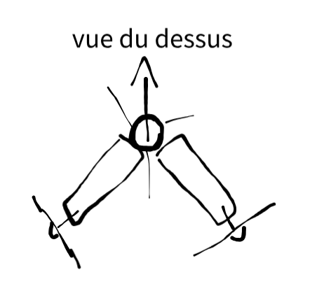
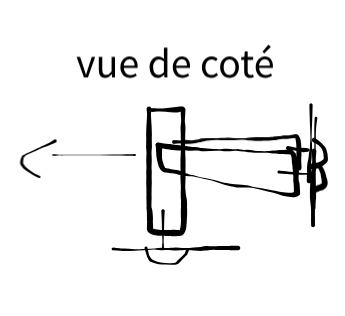
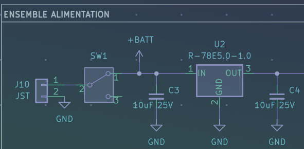
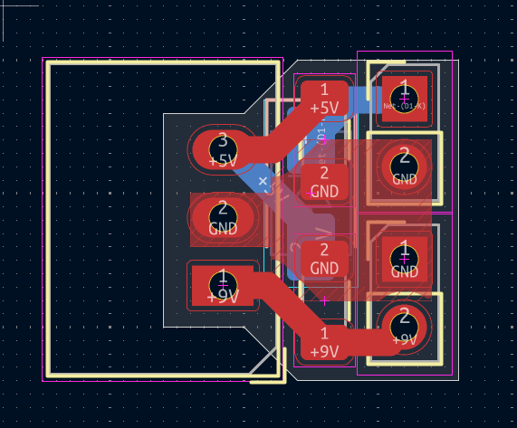
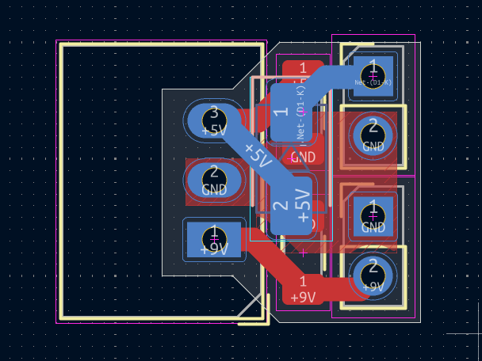
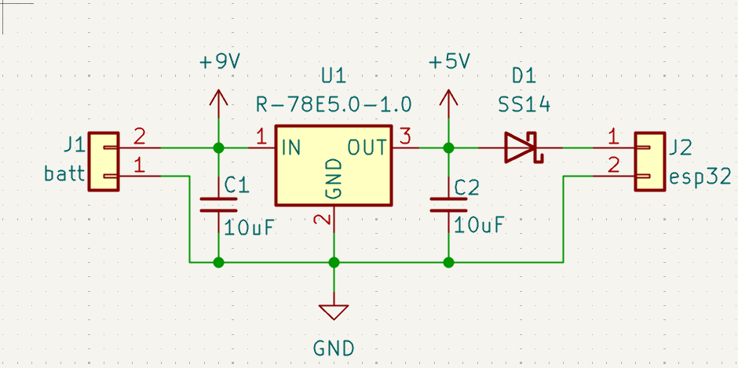
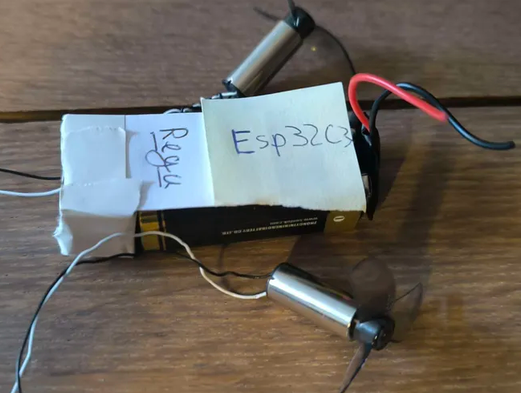

# projet dirigeable:

### ajourd'hui je regarde pour réaliser mon projet de dirigeable.

## composants évidents pour l'instant :
- microcontroleur 
- 3 moteurs / hélices (pour gauche/ droite, avance/recule, monter/ descendre)
- pile élec

## objectif :
### réduire au maximum de poids car chaque gramme correspond a un litre d'helium a ajouter (1.04 g/L ) attention a ne pas oublier le poids du ballon

### se déplacer comme je veux dans les trois dimentions. pour cela 3 moteurs me parèssent suffir si je les placent en de la manière suivente : 
- le premier a la verticale vers le bas pour monter et descendre sens géner avec le ballon.
- et les deux autres a l'horisontale mais avec un angle de 45° sur la droite et la gauche diriger vers l'arrière du dirigeable.

## schémas du positionement des moteurs :
###  

## détaile technique de chaque composants : 

### le microcontroleur :
- xiao esp32 c3
- doit etre alimenter en 5V 
- a un émeteur bluetooth intégrer
- permet de controler les moteurs facilement.

### pile rechargeable 9V :
- pile carré rechargeable 
- 9 V ce qui oblige un regulateur 5v
- dimention : 45mm x 25mm x 17mm + 5mm de hauteur avec le conn alim

### moteurs :
- fonctionne entre 1.5v et 3.7v
- dimetions : 14m L, 8mm D
- helice tripale de diamètre 40m

## regulateur de puissance 9v -> 5v :

###  
### si j'utilise ça je dois faire une mini carte 

### précision : je n'utiliserais pas d'intérupteur et il n'y aura pas de sortie +batt et j'ajoute une schottky juste avant l'esp

### coté algo je pensse utiliser une app en BLE (remote XY) donc il faudras prévoire une maneuvre de de redéscente auto en cas de perte de courant ou sinon, simplement rendre le dirigeable légèrement plus lourd pour qu'il redescende de lui meme. je pense que le mieu est que si on perd le contacte, on redescent a fond jusqu'a retrouver le contacte, cela permètera au pilote de se raprocher.

### je pense utiliser simplement l'entenne de l'esp32C3 se sera sufisent.

## réalisation :
### schémas électrique de la carte plus routage (regulateur 9V -> 5V).
###  
### 

### positionnement des éléments 
### 