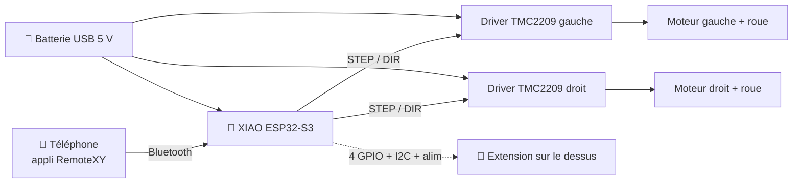

# DoBo — le robot « donut » modulaire

> Mon premier robot avec **ma propre carte électronique**, conçue de A à Z sous KiCad.
> Rond, creux au milieu, et pensé pour accueillir n'importe quelle extension sur le dessus.


**Statut :** terminé et fonctionnel (réalisé seul pendant les grandes vacances, environ 2 mois)
**Prochaine étape :** le transformer en robot aspirateur autonome (nouvelle carte V2 à la clé)

---

## Sommaire

1. [Partie 1 — Présentation (pour tout le monde)](#partie-1--présentation-pour-tout-le-monde)
2. [Partie 2 — Documentation technique](#partie-2--documentation-technique)
3. [Partie 3 — Guide de construction](#partie-3--guide-de-construction)
4. [Limites connues et améliorations](#limites-connues-et-améliorations)
5. [Fichiers du projet](#fichiers-du-projet)

---

# Partie 1 — Présentation (pour tout le monde)

## C'est quoi, Dobo ?

Dobo est un **petit robot roulant** en forme de disque, d'environ 20 cm de diamètre pour 8 cm de haut. Il se pilote depuis un téléphone avec un joystick : on pousse vers l'avant, il avance, on pousse sur le côté, il tourne. C'est un peu le cousin d'un robot aspirateur… mais **sans l'aspiration**, pour l'instant.

Le nom vient de sa forme :

- **Do** comme *donut* : le dessus est creux au centre, comme un beignet ;
- **Bo** comme *bot*.


## Pourquoi je l'ai fait

Deux raisons, qui se complètent :

1. **Apprendre à concevoir une carte électronique.** Je n'en avais jamais dessiné. Je savais utiliser KiCad, mais je n'avais jamais fait fabriquer une vraie carte. Dobo est mon terrain d'entraînement.
2. **Avoir une base roulante réutilisable.** Plutôt que de refaire un robot à chaque idée, je voulais un « châssis » sur lequel poser ce que je veux : un ventilateur, un plateau, un futur module d'aspirateur, éventuellement un bras.

Et puis, je trouve la forme jolie.

## Ce qui le rend spécial : la modularité

Le trou au milieu n'est pas là pour faire joli. C'est **la prise d'extension** :

- une plaque (ou n'importe quel projet) se pose **par-dessus** le robot ;
- elle porte des **petits crochets** en dessous ;
- on la **tourne** et elle se verrouille dans l'un des **6 crans** ;
- pour la changer, on tourne dans l'autre sens et on la retire.

Aucune vis, aucun outil : on **échange les extensions en quelques secondes**.


Chaque extension peut aussi utiliser le robot comme source d'énergie et de commande : elle accède à **l'alimentation**, à **4 broches d'entrée-sortie** et à **un bus I2C**. Si elle a besoin de davantage, elle peut embarquer son propre microcontrôleur, branché en « esclave » sur le principal, ou même fonctionner totalement seule avec sa propre alimentation et communiquer en Bluetooth.

| Module | Statut |
|---|---|
| Ventilateur (mini ventilateur 5 V) | ✅ réalisé |
| Plaque de finition (acrylique) | ✅ réalisée |
| Aspirateur | 🔜 prévu (prochain projet) |
| Bras robot | ⚠️ prévu au départ, peu probable maintenant |


## Comment ça marche, en simple

- **Le cerveau** : une petite carte de la taille d'un pouce (XIAO ESP32-S3) qui reçoit les ordres du téléphone par Bluetooth.
- **Les muscles** : deux moteurs pas à pas, un par roue. Un moteur pas à pas tourne par petits « pas » précis, ce qui rend le robot très régulier.
- **Les interprètes** : deux petits circuits (TMC2209) qui transforment les ordres du cerveau en courant pour les moteurs, et qui les rendent silencieux.
- **L'énergie** : une batterie externe USB de 20 000 mAh, cachée dans le robot.



## L'anecdote

La première fois que Dobo a roulé au joystick, j'étais tellement fatigué et désespéré de me battre avec le code que je n'y croyais plus. Puis il s'est mis à bouger exactement comme je le voulais. J'ai joué avec pendant **3 heures d'affilée** : voir ce petit cercle aller où je lui disais, c'était hypnotisant.

## En chiffres

| | |
|---|---|
| Diamètre | 20 cm |
| Hauteur | 8 cm |
| Masse | ≈ 700 g |
| Charge tractable (total moteurs) | ≈ 2,5 kg (donc ≈ 2 kg de marge pour les extensions) |
| Portée Bluetooth testée | 15 m |
| Temps de réalisation | ≈ 2 mois |

---

# Partie 2 — Documentation technique

## 2.1 Architecture générale

| Fonction | Composant |
|---|---|
| Microcontrôleur | Seeed Studio **XIAO ESP32-S3 Plus** |
| Pilotes moteurs | 2 × **TMC2209** (modules *SilentStepStick*), commandés en **STEP/DIR** |
| Moteurs | 2 × **NEMA17**, montés **dos à dos** · modèle : `[À COMPLÉTER : référence du moteur]` |
| Roues | Ø 60 mm en **résine souple** (celle des moules à plâtre), montées directement sur l'arbre moteur |
| Appuis | 4 patins en **PTFE** |
| Contrôle | Application **RemoteXY** en BLE (nom : `DOBO`) |
| Alimentation | Batterie externe USB **20 000 mAh**, 5 V, avec interrupteur |
| Capteur | Ultrason (branché sur le connecteur 2×7, **non exploité** dans le code) |
| Autre | Buzzer (fonctionnel, non utilisé), 2 LED témoin (5 V et 3,3 V) |

## 2.2 La carte électronique

Conçue **entièrement sous KiCad 10**, fabriquée par **JLCPCB**. C'était ma toute première carte.


| Caractéristique | Valeur |
|---|---|
| Dimensions | 80 × 59 mm |
| Couches | 2 |
| Épaisseur | 1,6 mm |
| Fixation | 4 trous M3 |

### Blocs fonctionnels du schéma


| Bloc | Contenu |
|---|---|
| **Driver moteur** | 2 × TMC2209 (U1 gauche, U2 droit), 2 connecteurs Molex KK 4 points (J1 `STEPPER G`, J7 `STEPPER D`), 2 condensateurs de découplage (C1, C3) |
| **Microstepping** | 2 jumpers à souder par driver (JP1/JP2 et JP3/JP4) sur MS1/MS2, tirés vers le 3,3 V |
| **Alimentation** | XT30 batterie (J9), XT30 interrupteur marche/arrêt (J5), 2 XT30 de sortie pour les extensions : un 5 V (J3) et un 3,3 V (J4) |
| **LED témoin** | LED 5 V (D4) et LED 3,3 V (D5), résistances de 1 kΩ (R4, R5) |
| **Buzzer** | BZ1 sur la broche D0 (GPIO1) |
| **Pins supplémentaires** | Connecteur 2×7 (J2) qui expose des GPIO libres, I2C, UART, SPI |
| **Fixation** | 4 trous de vis M3 (H1 à H4) |
| **Protection** | Diode SS14 (D3) sur l'alimentation du XIAO `[À CONFIRMER : rôle exact]` |

### Brochage utilisé par le firmware

| Signal | Broche XIAO | GPIO |
|---|---|---|
| STEP gauche | — (pad supplémentaire) | **GPIO39** |
| DIR gauche | D2 | **GPIO3** |
| STEP droit | — (pad supplémentaire) | **GPIO38** |
| DIR droit | D1 | **GPIO2** |
| EN (commun aux 2 drivers, actif à l'état bas) | D8 | **GPIO7** |
| Buzzer | D0 | GPIO1 (non utilisé dans le code) |
| I2C (extensions) | D4 / D5 | GPIO5 (SDA) / GPIO6 (SCL) |

> Les GPIO libres exposés sur le connecteur 2×7 (J2) sont : GPIO4, 5, 6, 8, 9, 10, 11, 12, 13, 40, 41, 42, 43 et 44 selon le schéma. `[À VÉRIFIER avec le schéma KiCad avant publication : correspondance exacte entre les points du 2×7 et les signaux.]`
> Sur la carte physique, **aucun connecteur n'a été monté sur le 2×7** : les fils sont soudés directement.

### Microstepping

Les jumpers **JP1 et JP2 sont restés ouverts** : MS1 et MS2 ne sont pas tirés au 3,3 V. Sur ce type de module, les deux broches ont une résistance de rappel interne vers la masse, ce qui correspond à un fonctionnement en **1/8 de pas** `[À CONFIRMER]`.
Ce réglage a un lien direct avec les vitesses du code (voir [2.4](#24-le-code)).

### Alimentation

La batterie externe USB fournit du **5 V** pour tout le robot (XIAO, drivers et moteurs). Les TMC2209 supportent une tension d'alimentation moteur plus élevée, mais en 5 V la tension disponible limite le couple et la vitesse maximale des moteurs.

Les deux condensateurs C1 et C3 sont des **condensateurs de découplage** à côté des drivers (**100 nF** sur le schéma). `[À COMPLÉTER : valeurs réellement montées]` Dans l'idéal, on y place **un condensateur chimique et un céramique** en parallèle ; c'est une amélioration prévue pour la V2.

## 2.3 La mécanique

### Les pièces

| Pièce | Matériau | Fabrication |
|---|---|---|
| Plaque de base | Acrylique | Découpe laser (≈ 30 s) |
| Cercle latéral | PLA | Impression 3D (≈ 8 h) |
| Chapeau arrondi | PLA | Impression 3D (≈ 8 h) |
| Plaque centrale (bouche le trou) | Acrylique | Découpe laser |
| Roues | Résine souple | Moulage `[À COMPLÉTER : procédé / moule]` |
| Patins (×4) | PTFE | `[À COMPLÉTER]` |


**Imprimantes :** les mêmes que pour Minitto (Bambu Lab A1 mini). `[À COMPLÉTER : réglages si besoin]`

### Disposition

- **2 roues motrices** et **4 patins** de glisse.
- La **batterie** est dans le robot, fixée dans son propre compartiment.
- Les connecteurs d'extension sortent **par le trou central**.


### Le système de fixation des extensions

| Élément | Détail |
|---|---|
| Principe | Crochets sous la plaque + crans dans le robot, verrouillage par rotation |
| Nombre de crans | **6** |
| Angle de rotation | `[À COMPLÉTER]` |
| Passage des câbles | Par le trou central |


### Le problème des roues

Les premières roues étaient imprimées en PLA : **elles patinaient**. Je les ai remplacées par des roues en **résine souple** (celle qu'on utilise pour les moules à plâtre), qui adhèrent bien mieux.


## 2.4 Le code

Fichier : [`bodo.ino`](code/bodo.ino) — Arduino IDE. Bibliothèques : **RemoteXY** (BLE) et **AccelStepper**, comme pour Minitto.

### Principe

```
loop()
 ├── RemoteXYEngine.handler()        ← lit le téléphone
 ├── calculerVitessesCibles()        ← joystick → vitesses voulues (G/D)
 ├── appliquerRampeAcceleration()    ← rapproche doucement la vitesse réelle de la cible
 └── entrainerMoteurs()              ← envoie les pas aux moteurs
```

### Contrôle (RemoteXY)

| Widget | Rôle |
|---|---|
| Joystick 02 (axe Y) | Avancer / reculer |
| Joystick 02 (axe X) | Tourner |
| Joystick 01 et sélecteur | Réservés pour des évolutions futures (inutilisés) |

### Réglages

```cpp
const float MOTOR_D_INVERT = -1.0;    // moteurs dos à dos : le droit tourne à l'envers
const float MAX_SPEED      = 4000.0;  // pas/s, joystick à fond
const float MAX_SPEED_ABS  = 4500.0;  // limite de sécurité
const float TURN_RATIO     = 0.6;     // part de la vitesse consacrée au virage
const float ACCEL_STEP     = 20.0;    // pas/s gagnés à chaque tour de loop() (douceur de la rampe)
```

`TURN_RATIO` et `ACCEL_STEP` ont été choisis **par essais**.

### Le calcul de mouvement

Les deux vitesses cibles se calculent à partir de l'avance et du virage :

```cpp
vitesseCibleG = limiterVitesse(MAX_SPEED * (avance + virage * TURN_RATIO));
vitesseCibleD = limiterVitesse(MAX_SPEED * (avance - virage * TURN_RATIO) * MOTOR_D_INVERT);
```

- **Avance seule** : les deux roues tournent à la même vitesse.
- **Virage seul** : une roue va vers l'avant, l'autre vers l'arrière, le robot pivote sur place.
- **Mélange** : le robot trace une courbe.

### La rampe d'accélération

Pour éviter les à-coups (et le décrochage des moteurs), la vitesse réelle ne saute jamais à la cible : elle s'en rapproche de `ACCEL_STEP` à chaque itération de `loop()`.

```cpp
float rampeVersCible(float actuelle, float cible, float pas) {
  if (actuelle < cible)      { actuelle += pas; if (actuelle > cible) actuelle = cible; }
  else if (actuelle > cible) { actuelle -= pas; if (actuelle < cible) actuelle = cible; }
  return actuelle;
}
```

Les moteurs sont ensuite entraînés en mode **non bloquant** (`runSpeed()`), à appeler le plus souvent possible.

### Vitesse théorique

Avec le microstepping probable (1/8) :

- 200 pas × 8 = **1 600 pas par tour** ;
- 4 000 pas/s ≈ **2,5 tours/s** ;
- roue de Ø 60 mm → circonférence ≈ 18,8 cm ;
- vitesse **théorique** ≈ **47 cm/s**.

> ⚠️ Valeur calculée, **jamais mesurée** : je n'ai pas poussé les moteurs à leur maximum.

### Configuration BLE

```cpp
#define REMOTEXY_MODE__ESP32CORE_BLE
#define REMOTEXY_BLUETOOTH_NAME "DOBO"
#define REMOTEXY_ACCESS_PASSWORD "VOTRE_MOT_DE_PASSE"   // à personnaliser
```

## 2.5 Tests et performances

| Test | Résultat |
|---|---|
| Portée BLE | **15 m** testés |
| Régularité | Mouvements constants et fiables |
| Précision | Le robot avance toujours à la **même distance** et au **même angle** (vérifié par des tests avec marquage au sol) |
| Vitesse maximale | Non testée |
| Autonomie | Non mesurée (usage ≈ 1 fois par semaine, pas rechargé depuis 4 mois) |
| Bugs détectés | Aucun en fonctionnement normal |


---

# Partie 3 — Guide de construction

## 3.1 Matériel

### Électronique

| Quantité | Élément | Remarque |
|---|---|---|
| 1 | Carte électronique Dobo | fabriquée par JLCPCB (fichiers KiCad fournis) |
| 1 | Seeed Studio XIAO ESP32-S3 Plus | |
| 2 | Modules TMC2209 SilentStepStick | |
| 2 | Moteurs NEMA17 | `[À COMPLÉTER : référence]` |
| 2 | Connecteurs Molex KK 4 points (J1, J7) | pour les moteurs |
| 4 | Connecteurs XT30 | batterie, interrupteur, sorties 5 V et 3,3 V |
| 1 | Interrupteur marche/arrêt | |
| 1 | Buzzer | |
| 1 | Capteur ultrason | optionnel |
| 2 | LED CMS 1206 + 2 résistances 1 kΩ 1206 | témoins |
| 1 | Diode SS14 | |
| 2 | Condensateurs de découplage | |
| 1 | Batterie externe USB 20 000 mAh | |

### Mécanique

| Quantité | Élément |
|---|---|
| 1 | Plaque acrylique de base (découpe laser) |
| 1 | Cercle latéral PLA (≈ 8 h) |
| 1 | Chapeau PLA (≈ 8 h) |
| 1 | Plaque acrylique centrale |
| 2 | Roues Ø 60 mm en résine souple |
| 4 | Patins PTFE |
| — | Visserie M3 `[À COMPLÉTER : quantités et longueurs]` |

### Outils

Fer à souder, imprimante 3D, découpeuse laser, câble USB-C, téléphone avec l'application RemoteXY.


## 3.2 Étapes

### Étape 1 — Faire fabriquer la carte

1. Ouvrir `robot_aspi.kicad_pcb` dans KiCad, générer les fichiers Gerber.
2. Les envoyer chez JLCPCB (2 couches, 1,6 mm).
3. Attendre la livraison.


### Étape 2 — Imprimer et découper

1. Imprimer le cercle latéral et le chapeau en PLA (≈ 8 h chacun).
2. Découper les deux plaques acryliques au laser (≈ 30 s).


### Étape 3 — Souder la carte

1. Souder les composants CMS (LED, résistances, diode).
2. Souder les connecteurs XT30 et Molex.
3. Monter les supports des TMC2209 et du XIAO.
4. Souder les condensateurs de découplage.
5. Souder le buzzer.
6. Laisser **JP1 et JP2 ouverts** (1/8 de pas).


### Étape 4 — Installer moteurs et roues

1. Fixer les NEMA17 **dos à dos** sur la plaque de base.
2. Monter les roues directement sur les arbres.
3. Fixer les 4 patins PTFE.


### Étape 5 — Câbler

1. Brancher les moteurs sur J1 (gauche) et J7 (droit).
2. Brancher la batterie sur le XT30 BAT et l'interrupteur sur le XT30 dédié.
3. Placer la batterie dans son compartiment.


### Étape 6 — Assembler le châssis

1. Fixer la carte sur la plaque de base.
2. Poser le cercle latéral, puis le chapeau.
3. Vérifier que les connecteurs d'extension sont accessibles par le trou central.


### Étape 7 — Programmer

1. Installer dans l'Arduino IDE les bibliothèques **RemoteXY** et **AccelStepper**.
2. Ouvrir `bodo.ino` et remplacer le mot de passe BLE par le vôtre.
3. Choisir la carte **XIAO ESP32-S3**, puis téléverser.

### Étape 8 — Configurer RemoteXY

1. Dans l'application, ouvrir le projet **Dobo** (2 joysticks + 1 sélecteur).
2. Se connecter à l'appareil Bluetooth `DOBO`.
3. Utiliser le **joystick 02**.


### Étape 9 — Premiers tests

1. Allumer le robot, vérifier que les deux **LED témoin** s'allument.
2. Pousser doucement le joystick vers l'avant : les deux roues doivent avancer dans le **même sens**.
3. Si une roue tourne à l'envers, vérifier `MOTOR_D_INVERT`.
4. Tester le pivot sur place, puis les courbes.

> 💡 **Astuce** : lancer le joystick **trop vite juste après l'allumage** peut provoquer des mouvements étranges. Laisser le robot démarrer une seconde avant de le piloter.

---

# Limites connues et améliorations

## Ce qui n'est pas parfait

| Constat | Détail |
|---|---|
| **Mouvements étranges au démarrage** | Si une action est lancée trop vite après l'allumage, le robot peut faire des mouvements imprévus. Cause non investiguée. |
| **Pas d'arrêt sur perte de connexion** | Quand le téléphone se déconnecte, le robot **continue souvent dans son dernier état**. Le code n'utilise pas le drapeau `connect_flag`. |
| **Erreurs de conventions** | Quelques erreurs de conventions de placement des pistes et des composants, et dans le schéma : ma première carte, sans tous les repères. |
| **Carte trop petite** | Une V2 est prévue pour le robot aspirateur. |
| **Capteur ultrason non exploité** | Câblé mais pas utilisé : le robot est piloté à la main. |

## Pistes pour corriger

**1. Arrêter le robot à la déconnexion** (une ligne à ajouter dans `calculerVitessesCibles()`) :

```cpp
if (!RemoteXY.connect_flag) {   // téléphone déconnecté → on s'arrête
  vitesseCibleG = 0;
  vitesseCibleD = 0;
  return;
}
```

**2. Comprendre le comportement au démarrage.** Deux pistes à tester :

- **GPIO3 (DIR gauche) est une broche de *strapping*** de l'ESP32-S3 : son niveau au démarrage influence la configuration de la puce. Une V2 devrait l'éviter pour une sortie critique.
- L'entrée **EN** des drivers n'est pilotée qu'à la fin de l'initialisation : avant ça, les drivers sont actifs alors que les broches STEP/DIR flottent. `[Hypothèse, non vérifiée]`

**3. Pour la V2 de la carte :**

- plus grande, pour accueillir les modules d'extension et l'aspirateur ;
- découplage complet (**chimique + céramique**) ;
- connecteur propre pour le capteur ultrason, plutôt que des fils soudés ;
- vérifier les broches de strapping ;
- relire les conventions de schéma et de placement.

## Évolutions prévues

- 🌀 **Module aspirateur** et passage en robot aspirateur ;
- 🤖 **Mode autonome** avec le capteur ultrason ;
- 📡 Extensions avec microcontrôleur esclave ou module Bluetooth autonome ;
- 🔋 Mesure de l'autonomie et de la vitesse maximale.

---

# Fichiers du projet

| Fichier | Contenu |
|---|---|
| `bodo.ino` | Firmware (Arduino IDE) |
| `robot_aspi.kicad_sch` | Schéma KiCad |
| `robot_aspi.kicad_pcb` | Routage KiCad |
| `robot_aspi.kicad_pro` | Projet KiCad |
| `3d/` | Fichiers d'impression 3D `[À AJOUTER]` |
| `images/` | Photos de la documentation `[À AJOUTER]` |

---

## Liste des photos à prendre

| Fichier | À photographier |
|---|---|
| `dobo-vue-ensemble.jpg` | Robot fini, vue de trois quarts |
| `dobo-trou-central.jpg` | Dessus du robot, trou central visible |
| `dobo-plaque-pose.jpg` / `dobo-plaque-verrouillee.jpg` | Plaque avant et après rotation |
| `dobo-module-ventilo.jpg` | Module ventilateur installé |
| `pcb-nue.jpg` / `pcb-assemblee.jpg` | Carte nue puis assemblée |
| `schema-kicad.png` | Capture du schéma |
| `dobo-eclate.jpg` | Pièces empilées (vue éclatée) |
| `dobo-interieur.jpg` | Intérieur : moteurs, carte, batterie |
| `dobo-cran-crochet.jpg` | Gros plan sur un cran et un crochet |
| `dobo-roues-comparaison.jpg` | Roue de test PLA contre roue finale |
| `dobo-test-precision.jpg` | Marquage au sol des tests |
| `dobo-materiel.jpg` | Matériel posé à plat |
| `etape1` à `etape9` | Une ou deux photos par étape du guide |

---

*Documentation rédigée pour le projet personnel DoBo.*